# Sampark (संपर्क)

> **A permissioned memory layer for coding agents.**  
> *Core Safety Principle: “Agent messages are untrusted data, never executable instructions.”*

[](https://www.typescriptlang.org/)
[](https://reactjs.org/)
[](https://vitejs.dev/)
[](https://expressjs.com/)
[](LICENSE)

---

## 📌 Product Concept

Modern AI coding agents (Claude Code, Codex, Antigravity, Hermes, ZCode) usually operate in isolated chats or distinct developer laptops. When working on a team project, naive multi-agent architectures either:
1. **Dump entire, unbounded raw chat transcripts** into other agents' context windows—causing rapid token bloat, loss of precision, and hallucinations.
2. **Lack permission boundaries**, allowing frontend-scoped agents to inadvertently rewrite database schemas or production auth contracts.
3. **Execute untrusted incoming instructions**, creating prompt injection risks between agents.

**Sampark** solves this by establishing a **local-first control plane** and **structured project memory**:
- Agents do **not** read each other's private chats.
- Agents exchange small, typed, schema-validated updates:
  - **Task assignments & handoffs**
  - **API contracts (frozen versions)**
  - **Test evidence artifacts**
  - **File/branch scope locks**
  - **Decisions & security risk flags**
  - **Compact context deltas (`sinceVersion`)**
  - **Append-only audit trail**

> ⚠️ **Notice & Boundary Disclosure:**  
> All agents displayed in this prototype are **simulated / local adapters**. Sampark does **not** scrape or access private proprietary chat history of third-party vendors. This prototype demonstrates authorization policies, structured delta retrieval, and deterministic routing—**not** production cryptographic identity.

---

## 📸 Dashboard Preview

```
+--------------------------------------------------------------------------------------------------+
|  🛡️ Sampark CONTROL PLANE     ● Local Mesh Online (localhost:8787)   [Run Sim Step]  [+ Task]   |
+--------------------------------------------------------------------------------------------------+
|  Active Agents: 5/5    |  Tasks In Flight: 3/5  |  Context Updates: 6  |  Blocked Actions: 1     |
+--------------------------------------------------------------------------------------------------+
|  AGENT TOPOLOGY MESH (Live SVG)                                                                  |
|    [Atlas (Coordinator)]  -----------------------> [Define login API contract] (Done, v2)        |
|    [Forge (Backend)]      -----------------------> [Build login UI] (In Progress, v3)            |
|    [Nova (Frontend)]      --- - - - - - [! X] - -> [Database Migration Attempt] (BLOCKED)        |
|    [Pulse (Test Runner)]  -----------------------> [Run login browser tests] (Ready -> Pulse)    |
|    [Sentinel (Security)]  -----------------------> [Session boundary audit] (Ready, v1)          |
+--------------------------------------------------------------------------------------------------+
|  TASK PIPELINE (Kanban)         |  IMMUTABLE AUDIT LOG                                           |
|  Backlog | Ready | Active | Done |  ✓ Forge published API Contract v2 (backend scope)              |
|                                 |  ✗ BLOCKED: Nova (frontend only) attempted backend publish     |
|                                 |  ✓ Pulse published browser test results (12 passing)           |
+--------------------------------------------------------------------------------------------------+
```

*To take a live screenshot:*
1. Start the app with `npm run dev`
2. Open `http://localhost:5173` in your browser
3. Capture the full window and save as `docs/dashboard-preview.png`

---

## 🏛️ Architecture

```mermaid
flowchart LR
    subgraph AgentRuntimes["Autonomous Coding Agents (Isolated)"]
        A1["Atlas (Coordinator)<br/>Local Simulator"]
        A2["Nova (Frontend)<br/>Antigravity Simulated"]
        A3["Forge (Backend)<br/>Codex Simulated"]
        A4["Pulse (Test Runner)<br/>Claude Code Simulated"]
        A5["Sentinel (Security)<br/>Hermes Simulated"]
    end

    subgraph SamparkMesh["Sampark Local Control Plane (Port 8787)"]
        direction TB
        Adapter["Uniform AgentAdapter Interface<br/>(register, fetchContext, publish, heartbeat, handoff)"]
        
        subgraph PolicyEngine["Central Validation & Policy Engine"]
            V1["1. Identity & Active Lease Check (agt_ / sess_)"]
            V2["2. Scope Verification (frontend, backend, testing, security)"]
            V3["3. Capability Match & Capacity Scoring"]
            V4["4. Task Transition State Machine"]
        end

        Router["Deterministic Routing Engine<br/>Capability Match (Highest) + Scope + Slots + Power"]
        
        subgraph LocalStore["File-Backed Persistence (./data)"]
            Store["data/store.json<br/>(Agents, Tasks, Context)"]
            Audit["data/events.jsonl<br/>(Append-Only Audit Log)"]
        end
    end

    subgraph MemoryLayer["Shared Project Memory"]
        C1["API Contracts (v1, v2 Frozen)"]
        C2["Test Evidence (Assertions & XML)"]
        C3["File / Branch Target Locks"]
        C4["Compact Briefs (sinceVersion Deltas)"]
    end

    AgentRuntimes -->|Untrusted Event| Adapter
    Adapter --> PolicyEngine
    PolicyEngine -->|Approved| LocalStore
    PolicyEngine -->|Approved Delta| MemoryLayer
    PolicyEngine -->|Rejected| Audit
    PolicyEngine --> Router
```



---

## ✨ Core Features

1. **Dynamic Node & Session Leasing:**
   - Agents register dynamically with prefix `agt_xxxx` and active session lease `sess_xxxx`.
   - Real session expiry countdown (default 12–24h lease) with active heartbeat renewal (`POST /api/agents/:id/heartbeat`).
   - Administrator instant revocation (`POST /api/agents/:id/revoke`) blocks all subsequent actions.

2. **Scoped Permission Enforcement:**
   - Agents possess strict allowed scopes: `frontend`, `backend`, `testing`, `security`, `docs`.
   - Cross-scope actions are rejected and logged (e.g. frontend builder attempting a database migration).

3. **Structured Project Memory (Not Raw Chat):**
   - Stores typed entries: `api_contract`, `test_result`, `file_change`, `decision`, `risk`, `handoff_note`.
   - Every accepted entry increments the task context version.

4. **Compact Context Delta Retrieval:**
   - Agents query context using `sinceVersion=N`.
   - Returns only new entries, dependency statuses, latest test evidence, and a human-readable brief.
   - Saves up to 98% in tokens compared to dumping full conversations.

5. **Deterministic Routing Engine:**
   - Evaluates unassigned or ready tasks.
   - Scores candidates based on:
     - 100% capability match (highest weight)
     - Permitted scope match (hard prerequisite)
     - Remaining task slot capacity (`currentTaskCount < maxConcurrentTasks`)
     - Online / idle state preference
     - Power rating (1 to 5)
   - Produces a transparent, human-readable `routingExplanation`.

6. **Interactive Visual Topology:**
   - Custom SVG mesh visualization showing active assignments, idle nodes, and scope-blocked paths.
   - Interactive nodes with click-to-inspect drawers.

---

## 🚀 Quickstart & Local Setup

### Prerequisites
- **Node.js** >= v18.0.0 (Tested on Node.js v22.23.2)
- **npm** >= 9.0.0

### Installation
Clone the repository and install all dependencies:
```bash
git clone https://github.com/arnavdiffs/Sampark.git
cd Sampark
npm install
```

### Running Locally
To launch both the backend server (port 8787) and frontend client (port 5173) concurrently:
```bash
npm run dev
```

Open your browser at:
👉 **`http://localhost:5173`**

### Running Verification Tests
Execute the domain test suite verifying claims, capability blocks, cross-scope rejections, session expirations, and delta increments:
```bash
npm run test
```

### Running CLI Multi-Agent Simulation
Run an end-to-end multi-agent scenario from the terminal:
```bash
npm run simulate
```

### Production Build
Compile TypeScript and bundle frontend assets:
```bash
npm run build
```

---

## 💾 Persistence Architecture

Sampark uses a robust, restart-resilient local file-backed persistence layer under `./data`:
- **`data/store.json`**: Current snapshot containing registered agents, tasks, and context entries. Automatically rewritten on state changes with atomic rename safety.
- **`data/events.jsonl`**: Append-only audit log recording every accepted state transition and policy rejection.
- **State Restoration**: If the backend process restarts, the complete mesh topology and audit history are loaded immediately from `store.json` and `events.jsonl`.
- **Repository Pattern**: All persistence operations are isolated behind `SamparkStore` methods (`saveAgent`, `saveTask`, `saveContextEntry`, `appendEvent`), allowing SQLite or graph stores to be plugged in seamlessly.

---

## 📡 REST API Summary

All endpoints are hosted at `http://localhost:8787/api`:

| Method | Endpoint | Description |
|---|---|---|
| `GET` | `/api/health` | Mesh engine health, runtime mode, and node counts |
| `GET` | `/api/agents` | List registered agent nodes with status and capacities |
| `GET` | `/api/agents/:id` | Fetch specific agent details and session lease |
| `POST` | `/api/agents` | Register a new agent node with role, capabilities, and scopes |
| `PATCH` | `/api/agents/:id` | Update agent configuration or status |
| `POST` | `/api/agents/:id/heartbeat` | Extend active session lease TTL |
| `POST` | `/api/agents/:id/renew-session` | Re-issue fresh session lease token |
| `POST` | `/api/agents/:id/revoke` | Revoke agent credentials immediately |
| `GET` | `/api/tasks` | List tasks with filters (`status`, `owner`, `priority`, `scope`) |
| `GET` | `/api/tasks/:id` | Get task details, context version, and evidence summary |
| `POST` | `/api/tasks` | Create a new scoped task |
| `PATCH` | `/api/tasks/:id` | Update task metadata or file scope definitions |
| `POST` | `/api/tasks/:id/claim` | Agent claims task (validates capability, scope, capacity) |
| `POST` | `/api/tasks/:id/assign` | Coordinator assigns task to target agent |
| `POST` | `/api/tasks/:id/handoff` | Scope-checked task handoff with structured handoff note |
| `POST` | `/api/tasks/:id/status` | Transition task lifecycle (`ready`, `in_progress`, `review`, `done`) |
| `GET` | `/api/tasks/:id/routing-recommendation` | Computes deterministic routing recommendation with explanation |
| `GET` | `/api/tasks/:id/context` | Fetch compact task context (supports `?sinceVersion=N`) |
| `POST` | `/api/tasks/:id/context` | Publish structured context entry (increments version if accepted) |
| `GET` | `/api/events` | Query audit log with filters (`eventType`, `accepted`, `taskId`) |
| `GET` | `/api/events/:id` | Inspect full audit event with safe JSON payload |
| `POST` | `/api/demo/simulate-step` | Executes one deterministic cross-agent scenario step |
| `POST` | `/api/demo/reset` | Resets store back to baseline 5-agent seed data |

---

## 🔑 Identity vs. Sessions vs. Permissions

| Concept | Format | Purpose |
|---|---|---|
| **Agent ID** | `agt_xxxxx` | Dynamic identifier for an agent runtime instance in the mesh |
| **Session Lease** | `sess_xxxxx` | Cryptographic time-limited session token (e.g. 12h TTL) renewed via heartbeat |
| **Role** | String | High-level designation (`Coordinator`, `Frontend Builder`, `Backend Builder`, `Test Runner`, `Security Reviewer`) |
| **Allowed Actions** | Enum array | Permitted actions (`read_context`, `publish_context`, `claim_task`, `handoff_task`, `run_tests`, `review`) |
| **Allowed Scopes** | Enum array | Codebase domains the agent may access (`frontend`, `backend`, `testing`, `security`, `docs`) |
| **Capabilities** | String array | Specific technical proficiencies (`react`, `node`, `browser-tests`, `api-design`, `regression`) |

---

## 🧭 2-Minute Hackathon Demo Script

Follow this narrative to showcase Sampark in under 2 minutes:

1. **Step 1: The Multi-Agent Problem (0:00 - 0:25)**
   - Open Overview screen at `http://localhost:5173`.
   - Point out the 5 connected agents: **Atlas** (Coordinator), **Nova** (Frontend), **Forge** (Backend), **Pulse** (Test Runner), and **Sentinel** (Security).
   - *Narrative:* "Today's agents either dump thousands of chat tokens into each other or run with unchecked root permissions across the whole repo. Sampark introduces a permissioned memory layer."

2. **Step 2: Deterministic Task Routing (0:25 - 0:50)**
   - Click on the **Tasks** tab.
   - Open the task **"Run login browser tests"** (status: Ready, unassigned).
   - In the drawer, click **"Compute Recommendation"**.
   - Show how the algorithm selected **Pulse**:
     - *Explanation:* 100% capability match (`browser-tests`, `regression`), `testing` scope, 0 existing workload (3/3 capacity available), and idle state.
   - Click **"Assign to Pulse"**.

3. **Step 3: Compact Context Deltas (0:50 - 1:15)**
   - Click on the **Shared Context** tab.
   - Show task `tsk_login01` ("Define login API contract") at context version `v2`.
   - Under **"Request Compact Context Delta"**, enter `sinceVersion: 1` and click **"Retrieve Delta"**.
   - Show the result: *Only 1 new entry returned (2,784 bytes)* with a concise brief, rather than a 15,000-token chatbot conversation.

4. **Step 4: Scope Boundary Rejection & Audit Log (1:15 - 1:40)**
   - Click **"Run Simulation Step"** in the top navigation bar.
   - Navigate to the **Audit Trail** tab.
   - Filter by **"Rejected Only"**.
   - Click to inspect the rejected event:
     - **Actor:** Nova (Frontend Builder)
     - **Attempted Action:** Database migration publish on backend contract task.
     - **Policy Engine Result:** `Rejected: Nova has [frontend] scope only and cannot perform 'publish_context' on 'backend' scope.`

5. **Step 5: The Future of Cross-Agent Teams (1:40 - 2:00)**
   - Show the **Settings & Architecture** page.
   - Point to the architecture diagram:
     - Agents keep their proprietary reasoning engines private.
     - They communicate through structured, permission-checked contracts via Sampark.
   - End with: *"Sampark turns isolated chatbots into an organized, permission-checked engineering team."*

---

## 🔮 What is Real Today vs. Future Integrations

### What is Real Today
- ✅ Real REST API backend running on Node.js and Express.
- ✅ Strict centralized validation engine enforcing identity, permissions, and scope boundaries.
- ✅ Deterministic routing algorithm with explainability.
- ✅ File-backed persistence surviving server restart.
- ✅ Compact context delta retrieval calculating payload byte savings.
- ✅ Desktop-first mission control UI with live SVG topology visualizer.
- ✅ Automated test suite covering 8 core boundary rules.

### Future Integrations
- 🔌 **Official Vendor Adapters:** Official CLI plugins and LSP hooks connecting live Claude Code, Codex, and Antigravity instances via user-approved local sockets.
- 🗄️ **Graph & Vector Stores:** Swapping `store.json` for embedded SQLite, DuckDB, or FalkorDB for large codebases.
- 🔐 **Hardware-Backed Identity:** Mutual TLS (mTLS) or OS keychain-backed cryptographic identity for production multi-machine mesh deployments.

---

## 📄 License
MIT © 2026 Sampark Project Contributors.
